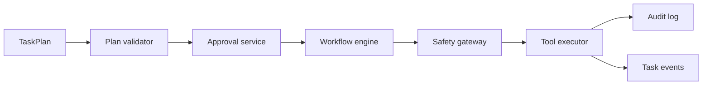

# ScreenPilot — portfolio presentation

## Project summary

ScreenPilot is a **safety-first AI agent platform** that lets users submit natural-language tasks, receive **validated multi-step plans**, and execute them through a **controlled tool layer** with **human approval** for risky actions. It includes a **React operations dashboard** with **live task telemetry**.

## Problem statement

General-purpose agents that call OS and browser primitives without guardrails create **security, privacy, and trust** risks: cross-user data leaks, prompt injection from untrusted pages, irreversible actions, and opaque progress UIs that hide real backend state.

## Solution

ScreenPilot treats the agent as a **regulated execution service**:

- **Authenticated, user-scoped** tasks and events
- **Structured plans** validated before persistence
- **Approvals** for high-risk categories (e.g. purchase flows in mock planner)
- **Tool gateway** enforcing permissions, injection rules, and confirmation
- **Workflow engine** with deterministic retries, pause, and cancel
- **Realtime events** from the backend (not simulated UI timers)

## Key engineering decisions

| Decision | Rationale |
|----------|-----------|
| Mock LLM default | Reproducible tests, demos, and CI without API keys |
| LangGraph for phases | Clear node boundaries (plan vs execute vs approval) |
| Postgres as source of truth | Tasks, approvals, audit, events durable and queryable |
| In-process event broker | Simplicity for single-node Compose; documented scaling limit |
| WebSocket token in query | Works with browser WS API; documented tradeoff vs cookie auth |
| Feature flags for automation | Safer default deploy without Playwright in API container |

## Agent workflow

Interpret intent → generate plan → validate schema/safety → persist steps → approval gate → workflow execution → tool calls with safety checks → terminal status + events.

## Safety architecture

Layers: **risk classification**, **argument sanitization**, **permission matrix**, **human confirmation**, **untrusted observation** wrappers for future prompt stuffing.

## Technical challenges

- **Ordering and idempotency** across workflow steps and event sequences
- **Concurrent cancel/pause** while async tools run
- **Browser URL policy** balancing local dev vs SSRF resistance
- **Frontend realtime** with reconnect + resume without duplicate UI state
- **Test pyramid** separating SQLite API tests from Playwright browser tests

## What was tested (facts)

- Backend pytest: **112 passed** (4 skipped) on 2026-11-24
- Frontend Vitest: **10 passed**
- Docker: compose valid; backend + frontend **image build** succeeded
- Full `docker compose up` end-to-end smoke: **not automated** in Phase 15

## Future improvements

See [PHASE15_FINAL_RELEASE_REPORT.md](PHASE15_FINAL_RELEASE_REPORT.md#12-future-improvements-honest-backlog).

## Links

- [README](../README.md)
- [Architecture](ARCHITECTURE.md)
- [Test report](PHASE13_TEST_COVERAGE_REPORT.md)